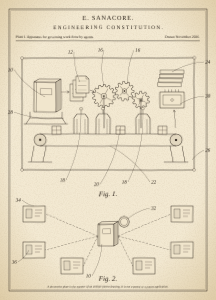

# Drawings

The framework's plate: the constitution drawn as a machine, in the manner of an antique patent drawing. The standard that asks every adopting repository for one is `DOCUMENTATION.md`, "Drawings" (ADR-0008).



A decorative plate. It is not a patent or a patent application.

## Key

Fig. 1 is one adopting repository at work. Fig. 2 is the fleet: one constitution, many repositories pinned to it.

| No. | Part |
| --- | --- |
| 10 | The constitution: principles and standards, one bound text |
| 12 | Instruction files, one per agent tool, all carrying the same guidance |
| 16 | The Required Workflow: plan, build, verify, turning together |
| 18 | Checkers: gates every change passes through |
| 20 | A change in progress |
| 22 | Continuous integration: the belt that carries every change past every gate |
| 24 | Documents kept current: README, changelog, to-do list, handoff |
| 26 | An adopting repository |
| 28 | The submodule pin that holds the constitution at one version |
| 30 | The session log: what was asked and decided |
| 32 | A release tag |
| 34 | An adopter in the fleet |
| 36 | That adopter's pinned copy |

## How it is made

`plate.svg` is the source: a hand-maintained SVG with no external fonts, images, or scripts. Edit it directly. The paper texture and the slightly unsteady line come from two SVG filters in its `<defs>` (`paper` and `hand`); everything drawn inside `<g filter="url(#hand)">` picks up the hand-drawn look.

Check it with:

```bash
bash scripts/check_drawings.sh --strict .
```

This repository has no physical component, so it carries the plate only and no drawing set.
