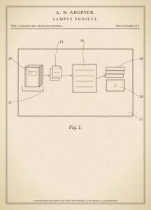

# Drawings

The sample project's plate: what a repository looks like after adopting the constitution. The standard is in `constitution/DOCUMENTATION.md`, "Drawings".

A decorative plate. It is not a patent or a patent application.

## Key

| No. | Part |
| --- | --- |
| 10 | The constitution, pinned as a submodule |
| 12 | The submodule pin |
| 14 | Agent instruction files |
| 16 | The project's own source (`src/`) |
| 18 | Required documents: README, changelog, to-do list |
| 20 | The session log |
| 22 | The repository |

## How it is made

`plate.svg` is a hand-maintained SVG. The sample project has no physical component, so there is no drawing set.
