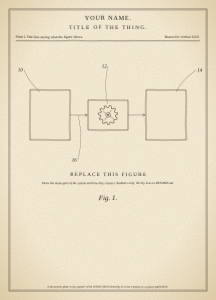

# Drawings

The project's plate: its main parts and how they connect, drawn in the manner of an antique patent drawing. The standard is in `constitution/DOCUMENTATION.md`, "Drawings".



A decorative plate. It is not a patent or a patent application.

## Key

One row per reference numeral on the plate. Numerals go up in twos (10, 12, 14) so a part can be added later without renumbering.

| No. | Part |
| --- | --- |
| 10 | Name the first part and say what it does |
| 12 | Name the second part |
| 14 | Name the third part |
| 16 | Name what moves between them |

## How it is made

Say what produces `plate.svg`: drawn by hand in the SVG, or generated by a script (name it and the command). Keep the plate free of external fonts, images, and scripts.

```bash
bash constitution/scripts/check_drawings.sh .
```

## Drawing set

Only for a repository with a physical component: link every sheet of the dimensioned drawing set here (SVG or PDF), with the command that regenerates it from the CAD. The least a set carries is listed in `constitution/DOCUMENTATION.md`, "The Drawing Set"; hold that floor in a test. Delete this section if the project has nothing physical.
